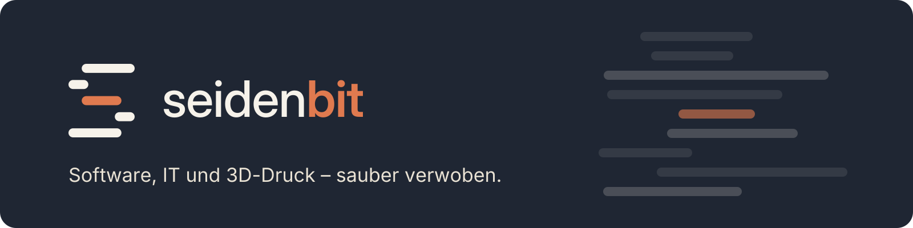

  

Seidenbit entwickelt Software: schlanke Web-Anwendungen und Werkzeuge für den IT-Betrieb und für kleine Unternehmen. Lieber wenige Produkte gründlich als viele halb – jedes soll eine klar umrissene Aufgabe zuverlässig lösen.
 
### Projekte
 
Hier stehen alle öffentlichen Projekte. Neue erscheinen automatisch.
 
<!-- projekte:start -->
<!-- Stand: 2026-11 -->
| Projekt | Worum es geht |
|---|---|
| **[Exitcheck](https://github.com/seidenbit/exitcheck)** | Wertet RVTools-Exporte für den Umstieg von VMware auf Proxmox VE oder Hyper-V aus: Kosten über einen frei wählbaren Zeitraum, Stolpersteine je VM und eine Aufwandsschätzung. Rechnet vollständig im Browser und sendet nichts. [Ausprobieren](https://seidenbit.github.io/exitcheck/) |
<!-- projekte:end -->
 
### Kontakt
 
Fragen, Fehler und Ideen bitte als Issue im jeweiligen Repository. Website und E-Mail-Adresse folgen in Kürze.
